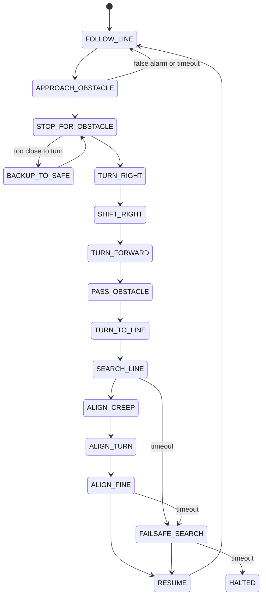

# BPUT T12 line-following and obstacle-avoidance robot

An ESP32 robot that follows a line with a PD controller and avoids a box obstacle on its right using a VL53L0X-compatible time-of-flight (ToF) sensor and a time-based state machine. The repository contains the competition sketch for the BPUT Tech Carnival 2026 T12 event, plus the hardware notes needed to wire and calibrate the reference design.

> **Important known limitation:** the reference build reports IR1 (GPIO14) as defective, but the firmware still samples it and includes it in the weighted line-position calculation. It is **not masked in software**, so a faulty IR1 signal can affect steering. Verify or repair that input before relying on the robot. The root-level `main.ino` source marks four reference-robot constant changes with `CHANGED (repo)`; no firmware logic was changed during this documentation review.

This repository has root-level documentation files rather than separate `docs/`, `hardware/`, or `diagrams/` directories. Use the links below as the current file map.

## Features

- PD line following on binary sensors with a weighted-average position, speed reduction on error and a soft start
- Lost-line handling: straight crossing of short gaps, edge-exit pivot, widening in-place sweep, timeout halt
- ToF obstacle detection on a core-0 task with validity filtering, consecutive-reading confirmation and staleness checks
- Safe stop distance calculated from the robot's geometry
- Time-based detour on the right side (turn, shift, turn, pass, turn, search)
- Line reacquisition, separate "line found" and "aligned" tests, automatic resume
- Failsafe sweep, timeouts at every stage, brake-and-halt behaviour
- Non-blocking 250 Hz control loop; serial commands for calibration and for testing each motion

## Hardware

| Block | Part |
|---|---|
| Controller | ESP32 Dev Module |
| Motor driver | TB6612FNG |
| Motors | 2 x BO geared DC motors, differential drive |
| Line sensors | 7 digital inputs; IR1 (GPIO14) is reported defective on the reference robot but is still sampled and weighted by the firmware; IR2–IR7 are the six working sensors reported for the reference build |
| Distance | VL53-series ToF, VL53L0X-compatible, I2C |
| Gyro | available, **not used** by the sketch |
| Power | 7.4 V battery, "Total 360" buck converter for the electronics |
| Chassis | custom, about 250 mm long, about 190 mm wheel span/width |

Parts and verification notes: [`BOM.md`](BOM.md), [`PINOUT.md`](PINOUT.md), and [`POWER_ARCHITECTURE.md`](POWER_ARCHITECTURE.md).

## Electrical architecture

```
7.4 V battery --+--> TB6612FNG VM --> BO motors
                |
                +--> "Total 360" buck --> ESP32, IR sensors, ToF
ESP32 3V3 --> TB6612FNG VCC (logic)        all grounds common
```

The buck output voltage and current, the battery capacity and the motor ratings are not given in the
project information: **USER MUST VERIFY** them. See [`POWER_ARCHITECTURE.md`](POWER_ARCHITECTURE.md).

## Pinout

| Function | GPIO | | Function | GPIO |
|---|---:|---|---|---:|
| PWMA (left speed) | 25 | | IR1 (reported defective; still sampled) | 14 |
| AIN1 | 26 | | IR2 | 13 |
| AIN2 | 27 | | IR3 | 16 |
| STBY | 5 | | **IR4 (centre / reference)** | **17** |
| BIN1 | 33 | | IR5 | 18 |
| BIN2 | 4 | | IR6 | 19 |
| PWMB (right speed) | 32 | | IR7 | 23 |
| SDA | 21 | | SCL | 22 |

TB6612FNG: `VCC` to 3.3 V logic, `GND` common, `AO1/AO2` left motor, `BO1/BO2` right motor.
Left motor: `AIN1`/`AIN2` set direction, `PWMA` sets speed. Right: `BIN1`/`BIN2` direction, `PWMB`
speed. `STBY` enables the driver. See [`PINOUT.md`](PINOUT.md) for the GPIO map and [`POWER_ARCHITECTURE.md`](POWER_ARCHITECTURE.md) for the power diagram and electrical checks. There is no separate wiring-document file in the current tree.

## Software architecture

The sketch is [`main.ino`](main.ino). Its `loop()` control path runs at `LOOP_US = 4000 us` (250 Hz), while a ToF task pinned to core 0 publishes distance snapshots for the control loop; obstacle handling uses the non-blocking `runStep()` state machine. [`parameter_template.h`](parameter_template.h) is a reference worksheet and is not included by the firmware. Separate architecture and diagram files are not present in the current tree.

## Control algorithm

Each sensor input gives line / no line. The firmware samples all seven inputs with weights (IR1..IR7) `-3, -2, -1, 0, +1, +2, +3`; IR4 (GPIO17) is the zero reference. **IR1 remains in this calculation despite being reported defective on the reference robot.** The code does not currently exclude it, so confirm its output is reliable before testing steering.

```
pos   = sum(w_i * s_i) / sum(s_i)           err = pos   (positive = line on the right)
corr  = KP*err + KD*dFilt                   KP = 32, KD = 70 (per tick), dFilt is filtered (err - lastErr)
base  = max(BASE_SPEED - SLOWDOWN*|err|, MIN_SPEED) * ramp, capped
V_left = base + corr     V_right = base - corr     each constrained to [-MAX_REVERSE, 255]
```

No integral term: nothing to cancel on a flat track, and it would wind up during line loss. Lost line:
`GAP_CROSS_MS = 180` ms of straight driving (or an edge-exit pivot), then a widening sweep for up to
`SEARCH_TIMEOUT_MS = 3500` ms, then halt. The implementation and tunable constants are in [`main.ino`](main.ino) and the non-included [`parameter_template.h`](parameter_template.h) worksheet.

## Obstacle avoidance mathematics

Reference robot: `L = 250 mm`, `W = 190 mm`, ToF-to-rotation-centre 90 mm, box 100 mm, margin 20 mm.

```
R_corner   = sqrt((L/2)^2 + (W/2)^2) = sqrt(125^2 + 95^2) = 157.003 -> 158 mm
D_min_safe = 90 + 158 + 20 = 268 mm
stop 300 mm | trigger 400 mm | clear 440 mm | emergency 250 mm
D_right    = 100/2 + 190/2 + 20 = 165 mm
D_forward  = 300 + 100 + 250/2 + 20 = 545 mm
t_ms       = D_mm / V_mm_per_s * 1000      (DRIVE_MM_PER_SEC = 200)
RIGHT_SHIFT_MS = 825 ms   FORWARD_PASS_MS = 2725 ms
```

The stop value is 300 because `OBSTACLE_STOP_MM = 300` is set; the calculated minimum plus the 20 mm braking allowance would give 288. `DRIVE_MM_PER_SEC = 200` and the turn times are placeholders, not measured performance. Measure the robot geometry, straight-line speed, and turn timings on the actual chassis before relying on the detour. The firmware prints derived distances with serial command `g`; the constants are in [`main.ino`](main.ino).

### State machine



The diagram above summarizes the state flow implemented in `main.ino`; there is no separate diagram file in the current tree.

## Robot geometry

The geometry constants (`ROBOT_LENGTH_MM`, `ROBOT_WIDTH_MM`, `TOF_SENSOR_TO_ROTATION_CENTER_MM`,
`OBSTACLE_WIDTH_MM`, `SAFETY_MARGIN_MM`) feed the stop distance and the detour. They are the reference
robot's values, not universal ones. `GEOMETRY_MEASURED` stays `false` until you have measured them.

### How to recalculate the robot for your own size

1. Measure the five geometry constants and edit them.
2. Press `g` on the serial monitor to see the derived distances.
3. Measure `DRIVE_MM_PER_SEC` at `AV_DRIVE_SPEED` on your floor.
4. Calibrate `TURN_RIGHT_MS` / `TURN_LEFT_MS`.
5. Run the detour test (`o`), then the full course.

Use [`parameter_template.h`](parameter_template.h) as a worksheet for the geometry and tuning constants. It is not included by the firmware; transfer only measured and verified values into `main.ino`.

## Calibration

Order: motor direction and trim, IR hardware (height, pot, order, polarity), ToF, geometry, `DRIVE_MM_PER_SEC`, turn times, then the detour. In the Serial Monitor at 115200 baud, use `h` for help, `c` for calibration only, `i` for raw/active IR diagnostics, `v` for ToF distance, and `g` for derived geometry. The current repository does not include a separate calibration checklist.

## Parameter tuning

Start at a low `BASE_SPEED`, tune `KP` until curves are followed but the robot starts to oscillate, add `KD` to damp it, then raise speed in small steps. The constants are in [`main.ino`](main.ino); [`parameter_template.h`](parameter_template.h) is a non-included worksheet, not a second source of firmware settings.

## Build instructions

1. Assemble the chassis, mount the sensor bar rigidly across the front with IR4 on the centreline,
   mount the ToF sensor facing forward on the centreline.
2. Wire everything using [`PINOUT.md`](PINOUT.md) and [`POWER_ARCHITECTURE.md`](POWER_ARCHITECTURE.md). Verify the buck converter's output voltage before connecting the ESP32; verify battery polarity and common ground.
3. Adjust the potentiometer on each IR module so it switches cleanly between line and floor.

## Upload instructions

1. Arduino IDE with the ESP32 board package (core 2.x or 3.x). Board: **ESP32 Dev Module**.
2. Library Manager: install **Adafruit VL53L0X** (it pulls in Adafruit BusIO).
3. Open the root-level `main.ino` in Arduino IDE. If the IDE asks to place the sketch in a folder named `main`, accept the prompt or make a `main/` folder and place a copy of `main.ino` there.
4. Select the port, upload, open the Serial Monitor at **115200 baud**.
5. The start-up log should show `VL53L0X OK`, then the geometry and a warning if `GEOMETRY_MEASURED` is `false`.

## Testing procedure

Never start at full speed.

1. **Power test**: voltages, polarity, no resets.
2. **Motor test**: `t`, wheels lifted.
3. **IR sensor test**: `i`, order and polarity; `c`.
4. **ToF test**: `v`, readings at known distances.
5. **Straight line test**: low `BASE_SPEED`.
6. **Curve test**: tune `KP`, `KD`, then speed.
7. **Lost line test**: gaps and an end-of-track.
8. **Obstacle detection test**: approach slowly, watch the log.
9. **Emergency stop test**: put an object inside the emergency distance.
10. **Right-side detour test**: `o` from the stop position.
11. **Line reacquisition test**: repeat `o`; watch SEARCH_LINE and ALIGN.
12. **Full-track test**: with the obstacle, at reduced speed first.

## Troubleshooting

| Symptom | Checks |
|---|---|
| Calibration fails | Place IR4 on the line and IR1, IR2, IR6, and IR7 on the floor as the firmware expects. Adjust each sensor module's potentiometer until black and white produce stable digital levels, then send `c` and read the Serial Monitor output. |
| Steering jumps or the line position looks wrong | The firmware still samples and weights IR1 (GPIO14) even though it is reported defective on the reference robot. Check its output and wiring; do not assume it is ignored. |
| ToF sensor is not found or readings are stale | Check sensor power and logic levels, SDA GPIO21, SCL GPIO22, and the Adafruit VL53L0X library. Use serial command `v` to inspect distance readings. |
| Motors move in the wrong direction or the ESP32 resets | Lift the wheels before motor tests. Recheck the motor-driver wiring, common ground, battery polarity, and buck-converter output under load; see [`POWER_ARCHITECTURE.md`](POWER_ARCHITECTURE.md). |
| Robot halts after losing the line | Check sensor height/order/polarity and calibration. The current lost-line search is bounded by `SEARCH_TIMEOUT_MS`; it is designed to halt rather than search forever. |

## Safety notes

- Lift the wheels for the first motor test.
- Check battery polarity and the buck output before connecting the ESP32.
- ESP32 GPIOs are not 5 V tolerant; verify the IR modules' output level.
- Use short, thick wiring for motor current; keep logic wiring away.
- The sketch has no battery monitoring and no stall detection. Stop the robot (`s` or BOOT) if it misbehaves.
- The detour assumes the right side is free: the robot does not check.
- IR1 (GPIO14) is known defective on the reference robot but is still sampled and weighted; the current firmware does not mask it.

## Future improvements

Possibilities that are **not** in the current code: use the gyro for turns instead of timing, wheel encoders
for the shifts and the pass, battery-voltage compensation, an explicit IR1 mask, ToF-based verification
that the right side is free.

## Repository layout

```
main.ino                  ESP32 competition sketch and control logic
parameter_template.h      reference worksheet; not included by the firmware
BOM.md                    bill of materials and items to verify
PINOUT.md                 GPIO and motor-driver pin map
POWER_ARCHITECTURE.md     power diagram, supply checks, troubleshooting
CONTRIBUTING.md            contribution guidance
CODE_OF_CONDUCT.md         community conduct
LICENSE                   MIT license text (copyright holder is still a placeholder)
download                  contains ignore-pattern text but is not named .gitignore
```

The root file `download` contains ignore patterns, but Git does not apply them as ignore rules under that filename. It was left in place rather than renamed during this documentation-only pass.

## License

MIT, see [`LICENSE`](LICENSE). The copyright holder line is a placeholder: fill it in.


---

## Skills & technologies

[](https://github.com/NirmalyaLenka/LINE-FOLLOWING-ROBOT-FOR-BPUT-ROBO-COMP) · [](https://github.com/NirmalyaLenka/LINE-FOLLOWING-ROBOT-FOR-BPUT-ROBO-COMP)


## How it works

The firmware entry point is `main.ino`. Open the sketch in Arduino IDE, select the matching board and serial port, verify the pin mapping and required libraries, then compile and upload. Hardware behaviour must be validated on the actual board; a README alone does not prove the circuit is safe or working.


## Maintenance & Audit

- **Audit date:** 11 November 2026
- **Documentation status:** README reviewed and audit record added on this date.
- **Scope and evidence:** This is a documentation-level maintenance pass. It does not establish that source code compiles, dependencies are current, security has been tested, or runtime behavior has been verified.
- **Code and tests:** No new functional code changes or test results are claimed by this README update. Run project-specific build, test, and security checks before relying on the project.
- **Maintenance baseline:** Documentation status recorded through 11 November 2026; revisit setup instructions, dependencies, security, known limitations, and tests when the project changes.

## Contact

Maintained up to 26 November 2026.

If you encounter any problems, please contact [carmodbhai@gmail.com](mailto:carmodbhai@gmail.com).
